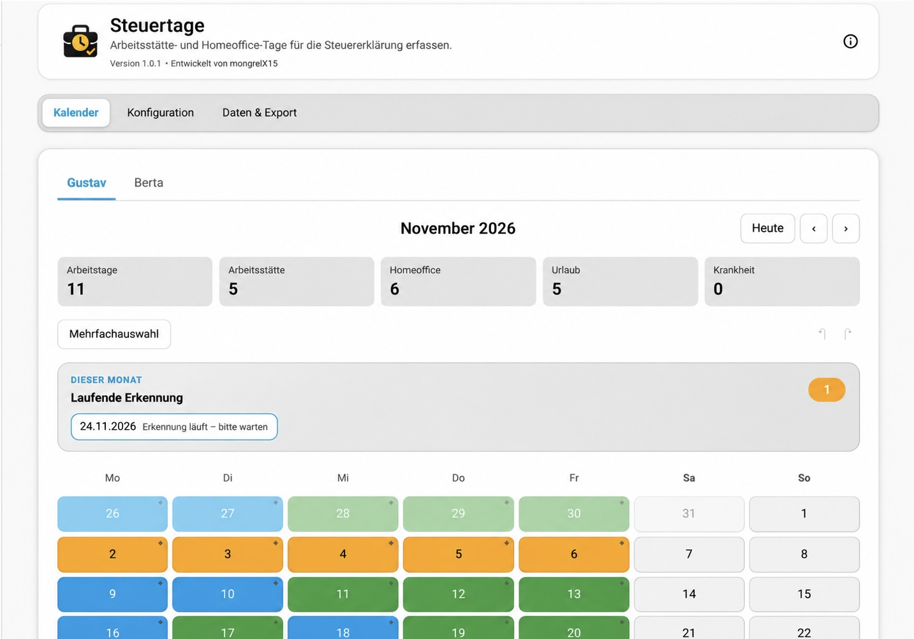
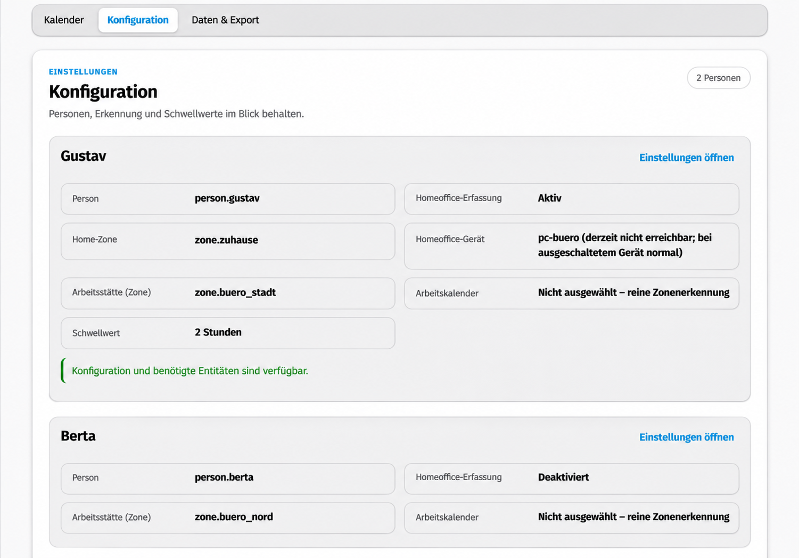
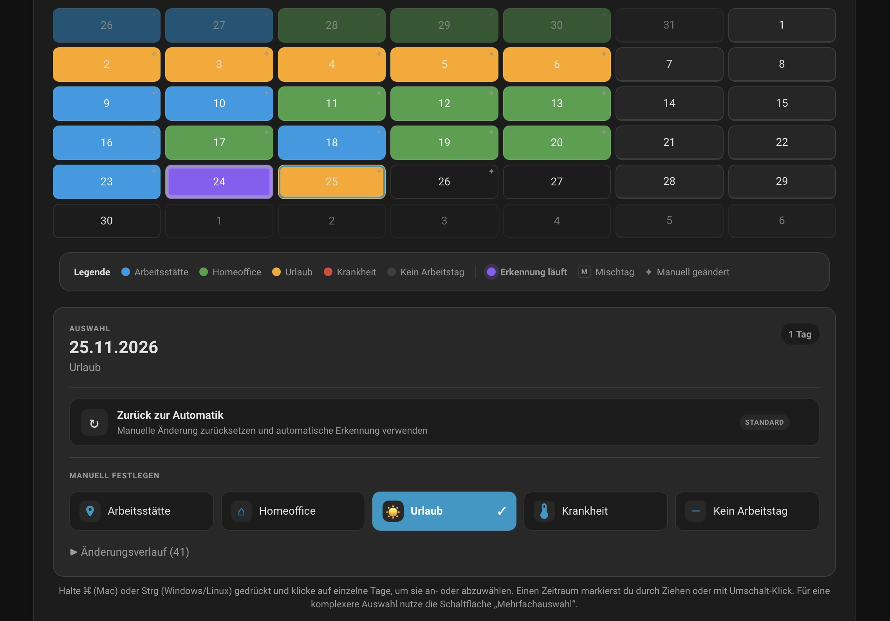
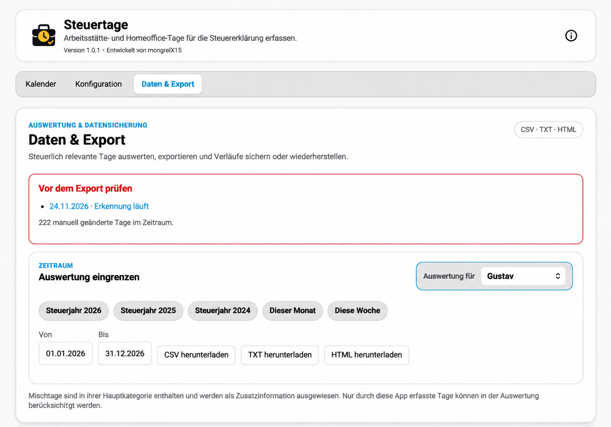
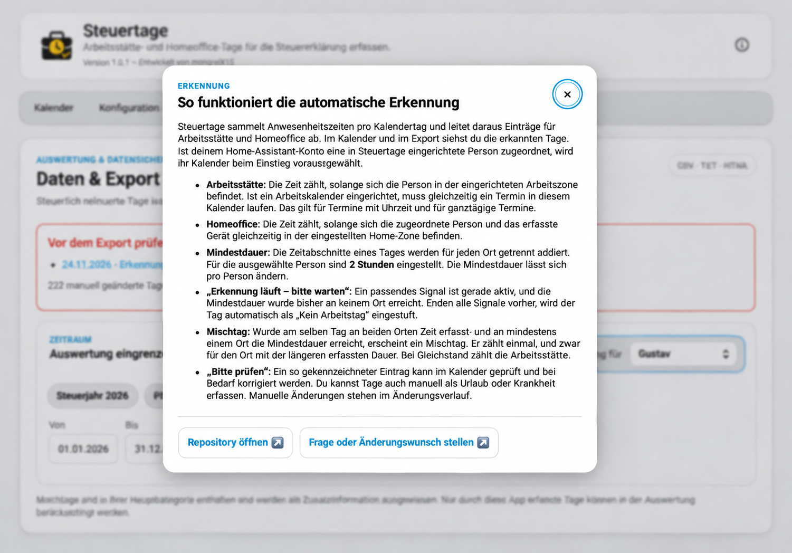

# Steuertage

**Steuertage** hilft dabei, Arbeitsstätte- und Homeoffice-Tage für die Steuererklärung in Home Assistant zu erfassen und auszuwerten. Die Integration erkennt Tage anhand deiner Zonen, optional deines Homeoffice-Signals und eines optionalen Arbeitskalenders. Im Seitenleisten-Panel kannst du Tage prüfen und manuell ändern, Auswertungen erstellen und deine Daten sichern.

> Steuertage unterstützt die Erfassung von Arbeitstagen. Für die Richtigkeit und Vollständigkeit der Steuererklärung bist du selbst verantwortlich. Alle Angaben ohne Gewähr.

## Was Steuertage kann

- **Kalender für mehrere Personen:** Jede eingerichtete Person erhält einen eigenen Verlauf. Die Ansicht wählt nach Möglichkeit automatisch die Person aus, die deinem Home-Assistant-Benutzer zugeordnet ist.
- **Automatische Erkennung:** Aufenthaltszeiten werden intern ausgewertet. Der Standard-Schwellwert beträgt 2 Stunden und lässt sich pro Person anpassen. Arbeitsstunden werden nicht als Tagesübersicht angezeigt.
- **Arbeitsstätte:** Wähle eine oder mehrere Arbeitszonen pro Person. Aufenthalte an verschiedenen Standorten werden am selben Tag zusammengerechnet; überlappende Zonen zählen nur einmal.
  Jeder Standort erhält eine dauerhaft stabile Nummer. Besuchte Standorte werden pro Tag gespeichert und können im Kalender manuell geändert werden. Alte Bürotage ohne eindeutige Standortdaten bleiben „Nicht zugeordnet“.
- **Homeoffice, wenn benötigt:** Die Homeoffice-Erkennung ist optional. Bei Aktivierung werden Home-Zone und Device Tracker konfiguriert; im Kalender und in der Auswertung erscheinen Homeoffice-Tage nur für Personen mit eingeschalteter Homeoffice-Erkennung.
- **Arbeitskalender, wenn benötigt:** Ein in Home Assistant eingebundener Kalender kann optional festlegen, wann ein Besuch einer der Arbeitszonen als Arbeitstag zählt. Zeitgebundene und ganztägige Arbeitstermine werden berücksichtigt.
- **Prüfen und korrigieren:** Offene Prüftage werden hervorgehoben. Du kannst einzelne Tage oder mehrere ausgewählte Tage manuell festlegen. Änderungen werden mit Zeitpunkt und Home-Assistant-Benutzer dokumentiert.
- **Auswertung und Sicherung:** CSV-, TXT- und HTML-Auswertungen enthalten Summen, Monatsübersicht, Tagesliste und Prüfhinweise. Eine JSON-Sicherung umfasst die Verläufe aller eingerichteten Personen.

## Installation

Steuertage ist im offiziellen Marketplace (ehemals HACS) verfügbar.

1. Öffne den **Marketplace** in Home Assistant und suche nach **Steuertage**.
2. Lade die Integration herunter und starte Home Assistant neu.
3. Öffne **Einstellungen → Geräte & Dienste → Integration hinzufügen**, suche nach **Steuertage** und folge dem Einrichtungsdialog.
4. Öffne anschließend **Steuertage** über die Seitenleiste.

Falls Steuertage nicht in der Marketplace-Suche erscheint, kannst du alternativ `mongrelX15/Steuertage` über **Benutzerdefinierte Repositories** als Repository vom Typ **Integration** hinzufügen.

Die stabile Version findest du unter [GitHub Releases](https://github.com/mongrelX15/Steuertage/releases/latest). Vorabversionen stehen auf der [Übersicht aller Releases](https://github.com/mongrelX15/Steuertage/releases). Für eine manuelle Installation kopiere `custom_components/steuertage` nach `<config>/custom_components/steuertage` und starte Home Assistant neu.

## Einrichtung

### Voraussetzungen für die automatische Erkennung

- **Person mit Standorterfassung:** Richte für jede erfasste Person in Home Assistant eine Personenentität mit einem Standorttracker ein, zum Beispiel über die Companion-App auf dem Smartphone. Steuertage nutzt den Standort dieser Person, um ihre Anwesenheit am Arbeitsort und zu Hause zu erkennen. [Personen in Home Assistant](https://www.home-assistant.io/integrations/person/)
- **Arbeitszonen:** Lege in Home Assistant Zonen für deine Arbeitsorte an und wähle sie in Steuertage als **Arbeitsstätten** aus. Die Auswahl ist optional; ohne Zone wird kein Bürotag automatisch erkannt. [Zonen in Home Assistant](https://www.home-assistant.io/integrations/zone/)
- **Homeoffice (optional):** Wenn du die Homeoffice-Erkennung aktivierst, wähle die Zone für dein Zuhause und einen Gerätetracker (`device_tracker`) für den Arbeitsrechner aus. Richte den Tracker vorher über eine passende Netzwerkintegration ein und prüfe, ob er erkennt, wann der Rechner im Heimnetz ist. Steuertage zählt die Zeit, in der die Person und der Arbeitsrechner gleichzeitig zu Hause erkannt werden. [FRITZ!Box Tools](https://www.home-assistant.io/integrations/fritz/) · [UniFi Network](https://www.home-assistant.io/integrations/unifi/)
- **Arbeitskalender (optional):** Wenn du diese Funktion aktivierst, wähle einen bereits in Home Assistant eingebundenen Arbeitskalender aus. Steuertage wertet die Anwesenheit in einer der Arbeitszonen dann nur während eines laufenden Termins.

Pro Person wird eine eigene Steuertage-Konfiguration angelegt. Die verfügbaren Einstellungen im Überblick:

| Einstellung | Erforderlich? | Zweck |
| --- | --- | --- |
| Home-Assistant-Person | Ja | Ordnet Standorterkennung und Verlauf der ausgewählten Person zu. |
| Arbeitsstätten (Zonen) | Nein | Erkennt Anwesenheit an beliebigen ausgewählten Arbeitsorten. |
| Erkennungsschwelle | Ja | Mindestdauer eines passenden Signals. Standard: 2 Stunden. |
| Homeoffice-Erkennung | Nein | Schaltet Homeoffice als Tagestyp hinzu. Bei Aktivierung werden die Home-Zone und der Gerätetracker des Arbeitsrechners benötigt. |
| Arbeitskalender | Nein | Begrenzt die automatische Wertung einer der Arbeitszonen auf Arbeitstermine im eingebundenen Home-Assistant-Kalender. |

Ohne Arbeitskalender zählt die erkannte Anwesenheit in einer der Arbeitszonen. Ist ein Arbeitskalender ausgewählt, zählen Aufenthalte in den Arbeitszonen nur während eines passenden laufenden Termins. Ein Homeoffice-Gerät, das nach der Arbeit ausgeschaltet oder nicht erreichbar ist, gilt nicht als Homeoffice-Signal.

## Kalender und Auswertung

Das Seitenleisten-Panel enthält die Bereiche **Kalender**, **Konfiguration** und **Daten & Export**. Die Oberfläche passt sich an das aktive Home-Assistant-Theme und den Hell-/Dunkelmodus an.

Im Kalender siehst du Tagesstatus, Monatsstatistik, Wochenenden und Hinweise auf manuelle Änderungen. Am Desktop lassen sich mehrere Tage über Ziehen, Umschalt-Klick oder ⌘-Klick (Mac) beziehungsweise Strg-Klick (Windows/Linux) auswählen. Auf Mobilgeräten kannst du die Mehrfachauswahl aktivieren und einzelne Tage antippen. Für Ziehen und Umschalt-Klick kannst du die einzubeziehenden Wochentage pro Person festlegen, etwa „Wochenende auslassen“ oder ein individuelles Vier-Tage-Muster. Die Einstellung dient nur als Markierhilfe; einzelne Klicks und Feiertage bleiben auswählbar. Arbeitsstätte und Homeoffice können am selben Tag als Mischtag erfasst werden; dabei zählt der Tag insgesamt nur einmal.

Im Kalender kannst du Arbeitsstandorte direkt per Klick zu- und abwählen. Bei mehreren markierten Tagen ergänzt ein Klick einen aktiven Standort auf den Tagen, an denen er fehlt. Ist er auf allen markierten Tagen zugeordnet, entfernt ein Klick diese Zuordnung. Ein Bürotag ohne Standort erscheint als „Nicht zugeordnet“.

Im Bereich **Daten & Export** kannst du Steuerjahre oder eigene Zeiträume auswählen. Monatsübersicht, Tagesliste und Änderungsverlauf lassen sich aufklappen. Die Exportdateien enthalten nur Tage, die Steuertage erfasst hat. Manuell als „Kein Arbeitstag“ markierte Tage werden nicht als Arbeitstage gezählt oder exportiert.

Die Standortübersicht zählt jeden Bürotag genau einmal. Tage mit mehreren Standorten erscheinen als Kombination, etwa „Bonn + Koblenz“. Der CSV-Tagesexport enthält alle besuchten Standorte in derselben Tageszeile. Historische Standorte erscheinen in der Auswertung, wenn sie im gewählten Zeitraum zugeordnet sind.

Unter **Historische Arbeitsstandorte** können Home-Assistant-Administratoren entfernte Standorte der ausgewählten Person über alle Steuerjahre einsehen und löschen. Steuertage sichert den Verlauf vor dem Löschen und entfernt nur die Standortzuordnungen. Tagestypen und andere Standorte bleiben erhalten.

## Entitäten für eigene Dashboards und Automatisierungen

Jedes eingerichtete Personenprofil erhält ein eigenes Steuertage-Gerät mit nativen Entitäten. Der bestehende Tagestyp-Sensor wird weiterverwendet; bestehende Entitätskennungen bleiben erhalten. Die tatsächlichen Entitäts-IDs kannst du unter **Einstellungen → Geräte & Dienste → Steuertage** ablesen und in Karten, Vorlagen oder Automatisierungen auswählen.

| Entität | Wert |
| --- | --- |
| Heutiger Tagestyp | Effektiver Tagestyp nach automatischer Erkennung oder manueller Korrektur |
| Heutige Arbeitsstätten | Namen der heutigen Standorte; die vollständigen Standortlisten stehen auch in den Attributen. Ohne zugeordnete Arbeitsstätte ist der Wert unbekannt. |
| Homeoffice-Tage / Arbeitsstätten-Tage im aktuellen Monat und Jahr | Anzahl der Tage pro Person; mehrere Standorte am selben Tag zählen nur einmal |
| Offene Überprüfungen | Anzahl aller noch als „Bitte prüfen“ eingestuften Tage |
| Überprüfung erforderlich | Ein, sobald mindestens ein solcher Tag vorhanden ist |
| Letzte automatische Erkennung | Zeitpunkt der letzten automatischen Auswertung; vor der ersten Auswertung unbekannt |

Die Entitäten aktualisieren sich bei Erkennung, manuellen Änderungen und Wiederherstellungen. Jeder Home-Assistant-Benutzer mit entsprechendem Zugriff auf Entitäten kann diese personenbezogenen Informationen sehen.

## Sicherung und Wiederherstellung

Steuertage erstellt automatisch alle sieben Tage eine lokale Sicherung unter `/config/.storage/steuertage_backups/`. Die Dateien werden vier Wochen aufbewahrt. Nach einer erfolgreichen Sicherung löscht Steuertage ältere automatische Sicherungen. Administratoren können die Dateien direkt im Dialog **Sicherung & Wiederherstellung** auswählen und wiederherstellen. Diese zusätzliche Hilfe ersetzt die regulären Home-Assistant-Backups nicht und bietet keinen Schutz vor einem vollständigen Datenträgerausfall.

Die Steuertage-Sicherung enthält die Verläufe aller in der Integration eingerichteten Personen, unabhängig von der aktuell angezeigten Person. Für das Erstellen und Wiederherstellen ist ein Home-Assistant-Administrator erforderlich.

Beim Wiederherstellen gibt es zwei Möglichkeiten:

- **Ergänzen:** Fehlende Einträge aus der Sicherung werden ergänzt. Neuere lokale Änderungen bleiben erhalten.
- **Ersetzen:** Einträge für Tage, die in der Sicherung enthalten sind, werden durch den Sicherungsstand ersetzt. Tage, die nicht in der Sicherung stehen, bleiben unverändert.

Eine Wiederherstellung betrifft nur Personen, die aktuell in Steuertage eingerichtet sind. Bewahre zusätzlich ein aktuelles Home-Assistant-Backup auf.

## Hilfe und Rückmeldungen

Fehler, Fragen und Vorschläge kannst du über [GitHub Issues](https://github.com/mongrelX15/Steuertage/issues) melden. Bitte füge keine Zugangsdaten, privaten Adressen oder personenbezogenen Kalenderdaten bei.

## Lizenz

Steuertage ist unter der **GNU General Public License, Version 3 (GPLv3)** veröffentlicht. Du darfst den Code unter den Lizenzbedingungen nutzen, ändern und weitergeben. Bei der Weitergabe veränderter Versionen gelten die GPLv3-Bedingungen für die Lizenzierung und den Zugang zum zugehörigen Quellcode. Der vollständige Lizenztext steht in der Datei [LICENSE](LICENSE).

## Entwicklung

Steuertage entsteht mit KI-Unterstützung und wird zunächst im `beta`-Zweig erprobt. Geprüfte Änderungen werden später als stabile Version in `main` veröffentlicht. Beta-Versionen können unvollständig sein oder Fehler enthalten.

Änderungen pro Version findest du in den [GitHub Release Notes](https://github.com/mongrelX15/Steuertage/releases).
